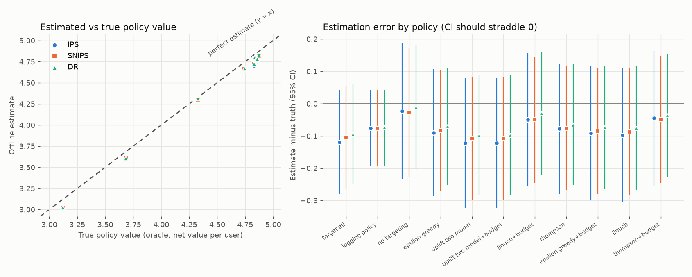

# TargetWise: Offline-Evaluated Audience Targeting Bandit

A contextual-bandit audience targeting system that learns which users to target under a budget, validated with counterfactual offline policy evaluation before any "launch".

Everything runs on a simulator with a known ground truth, so each estimator and decision can be checked against the true answer.

## Features

- **Logged-data simulator** (`simulator.py`): a known, confounded logging policy with logged propensities, heterogeneous treatment effects (some users are hurt by targeting), per-user targeting costs and Bernoulli conversions worth a fixed revenue.
- **Policy learners** (`learners.py`, `uplift.py`), with the linear bandits written from scratch in NumPy:
  - epsilon-greedy
  - LinUCB
  - Thompson sampling (Bayesian linear)
  - a two-model uplift baseline (T-learner, gradient boosting)
  
  The bandits learn from logs by replaying them with clipped inverse-propensity weights, and they also learn online (`update`, `simulate_online`).
- **Offline policy evaluation** (`ope.py`): IPS, self-normalised IPS and doubly robust estimators with confidence intervals from influence functions. Paired policy-vs-policy differences use the same log, so their intervals are tighter.
- **Budget-constrained targeting** (`budget.py`): ranks users by expected incremental value per cost, greedily fills the budget, and never targets users with an expected return below break-even.
- **A/B test module** (`abtest.py`, `decision.py`): power analysis (sample size, MDE, power, and a Monte-Carlo power check), a randomised test on fresh simulated users, and a go / no-go / inconclusive decision with a markdown report.

## Results at a glance

**Do the offline estimates match the truth?** Each policy was scored by the three estimators on a held-out log and by an oracle that knows the simulator's true outcome probabilities. Left: estimate vs truth (the dashed line is a perfect estimate). Right: the same data as error with 95% CIs; the intervals straddle 0.



All three estimators move together, because they share one evaluation sample. The common offset on the right is that sample's own noise, and it cancels when two policies are compared on the same log. That is why estimated *lifts* are much more accurate than raw values:

| Estimator | Median relative error | Max relative error | 95% CI coverage |
|---|---|---|---|
| DR | 3.0% | 6.2% | 100% |
| IPS | 3.5% | 5.2% | 100% |
| SNIPS | 1.9% | 3.6% | 100% |

Relative error is |estimated lift - oracle lift| / |oracle lift| for the lift of each budget-constrained candidate over the logging policy, over 5 seeds x 4 candidates (20 cases per estimator). Reproduce with `python -m scripts.make_docs`.

**Headline:** doubly robust offline lift estimates landed within **6%** of the oracle online lift (median 3%).

### Sample launch decision memo

This memo is generated by `render_memo` from the pipeline's own numbers (default seed). It is also in [`docs/sample_memo.md`](docs/sample_memo.md).

<details>
<summary>Open the one-page memo</summary>

### Launch decision memo: audience targeting policy `thompson+budget`

**Decision: GO**. Launch to the full audience with the budget cap and a holdout for monitoring.

#### Proposal
Replace the current targeting rule with a bandit-learned policy that targets users by expected incremental
revenue per unit cost, capped at 0.374 spend per user (30% of the cost of targeting everyone).

#### Evidence
- **Offline (counterfactual, 30000 held-out logged users):** doubly robust lift over the current rule is
  +1.23 net value/user (95% CI +1.09 to +1.36); IPS and self-normalised IPS agree in sign and size.
  Versus not targeting at all: +0.52 (+0.38 to +0.66).
- **Randomised A/B test (4575 users per arm):** lift +1.09 (95% CI +0.65 to +1.54),
  one-sided p = 7.8e-07. Spend per user: 0.306 vs 0.654 for the current rule.
- **Power:** the test was sized for 0.61, half of the offline lift, at 80% power and alpha = 0.05; needed 4575 per arm.
- **Why trust the offline numbers:** the estimators were also scored against oracle policy values: across 5 seeds x 4 candidates, the DR lift estimate was within 6% of the oracle online lift (median error 3.0%).

#### Decision criteria
- PASS: OPE: DR lift CI excludes 0 (lift +1.2255 [+1.0887, +1.3624])
- PASS: OPE: IPS, SNIPS, DR all positive (IPS +1.2198, SNIPS +1.2158, DR +1.2255)
- PASS: A/B: one-sided lower bound > min lift (lift +1.0947, lower bound +0.7199, p=7.778e-07)
- PASS: A/B: sample size meets power plan (n/arm 4575 vs required 4575)
- PASS: Budget respected (spend/user 0.3064 vs budget 0.3744)

#### Risks and mitigations
- **Selection optimism:** the candidate was picked as the best of four on the same log; the fresh-user A/B test is the unbiased confirmation.
- **Distribution shift:** the policy was learned from one logging period. Keep a randomised holdout and re-run offline evaluation monthly.
- **Overlap:** estimates are only valid where the old rule gave every user a non-trivial chance of each action (propensities in [0.1, 0.9]).
- **Simulation caveat:** these numbers come from a simulator with known truth, not production traffic.

#### Next steps
1. Roll out to a small share of traffic with the budget cap enforced. 2. Monitor realised spend and lift against the interval above. 3. Re-train and re-evaluate on fresh logs before widening.

</details>

## Architecture

```
simulator ──logged data──▶ learners / uplift model ──scores──▶ budget (threshold policy)
    │                                                            │ prob_treat(x, cost)
    │                                   ┌────────────────────────┘
    │                                   ▼
    │                          ope (IPS / SNIPS / DR, paired lifts) ──▶ pick best candidate
    │                                                                      │
    └──────── fresh users ────────▶ abtest (power plan, randomised test) ◀┘
                                              │
                                    decision (go/no-go) ──▶ report.md / results.json
```

Every policy exposes `prob_treat(X, cost)`, a vector of treatment probabilities. This one interface feeds both the OPE estimators and the simulated A/B test.
`targetwise/pipeline.py` wires the stages together.

## Setup

```bash
python3 -m venv .venv && source .venv/bin/activate
pip install -r requirements.txt
pip install -e .            # makes `targetwise` importable from the notebook and scripts
cp .env.example .env        # optional; every setting has a default, no secrets needed
```

## Run

The demo is a notebook that runs the whole flow and ends with the go/no-go report:

```bash
pip install -r requirements-docs.txt        # matplotlib + Jupyter (only needed for the notebook and charts)
jupyter lab notebooks/demo.ipynb            # or: jupyter nbconvert --to notebook --execute notebooks/demo.ipynb
```

[`notebooks/demo.ipynb`](notebooks/demo.ipynb) is committed with its outputs. It walks through the confounded logs, the estimated-vs-true chart, regret curves, the launch memo and the final report, and its last cell prints `DECISION: GO`.

Other entry points:

```bash
python -m targetwise.pipeline                      # CLI: prints the report, writes reports/report.md and reports/results.json
python -m scripts.make_docs                        # regenerates docs/ (chart, sample memo, accuracy table)
python -m scripts.make_notebook                    # rebuilds the notebook source (then re-execute it)
pip install streamlit && streamlit run app/streamlit_app.py   # optional interactive dashboard
```

Settings are `TW_*` environment variables (see `.env.example`): seed, log size, budget fraction, alpha, power, A/B sample-size cap and so on.

## Test

```bash
python -m pytest
```

The 30 tests cover:
- simulator confounding;
- learner fitting and exploration behaviour;
- OPE: confidence-interval coverage against the oracle policy value, DR robustness to a useless reward model, and DR variance below IPS;
- budget feasibility;
- sample-size formulas;
- Monte-Carlo vs analytic power;
- go/no-go logic;
- an end-to-end pipeline run, the launch memo and the chart.

## Resume line

> Built a budget-constrained targeting bandit (epsilon-greedy, LinUCB, Thompson sampling) with doubly robust offline evaluation; estimator error within 6% of ground-truth online lift.

On the simulated logs the naive treated-vs-untreated difference is +1.0 per user against a true average uplift of +0.04, so the unadjusted comparison is badly confounded. The winning budget-constrained candidate beat the current rule by about +1.2 net value per user on offline evaluation and +1.1 in the fresh A/B test, at about half the spend.

## Key design decisions

- **Reward is net of cost.** Reward is `value * conversion - cost * treated`. Cost is known, so the learners model revenue only and compare uplift against cost.
- **Action 0 is "do not target".** Each arm gets its own ridge model, which is a simple, transparent contextual-bandit formulation.
- **IPS-weighted replay for learning.** Logged data is confounded, so each arm's ridge statistics use clipped, mean-normalised inverse-propensity weights.
- **OPE target policies are deterministic or closed-form.**
  - Epsilon-greedy has exact probabilities.
  - Thompson sampling uses a fixed set of posterior draws, which gives a deterministic Monte-Carlo probability.
  - LinUCB is a deterministic rule.
  - The budgeted policy is a per-user ratio threshold calibrated on a reference population, using contexts only (no outcomes). That makes it a pure function of the user, which OPE needs.
- **Each bandit ranks users for the budget with its own score.** LinUCB uses optimistic uplift, Thompson sampling uses one posterior draw, and epsilon-greedy and the uplift model use the mean.
- **Honest data splitting.** Learners and the DR reward model are fitted on one half of the log, and OPE runs on the held-out half, so no cross-fitting is needed. The winning candidate is selected by the DR lower bound of its lift over the logging policy. That selection is mildly optimistic, which is why the confirmation A/B test uses fresh users.
- **Control arm = logging policy** (the current rule). The report also gives the lift over not targeting at all. In the simulator the logging policy is worse than no targeting, which is why the lift looks large.
- **Power planning uses a haircut.** The A/B test is sized for `TW_EFFECT_HAIRCUT` (default 50%) of the OPE lift, to allow for winner's curse. Sample size is capped by `TW_AB_MAX_N`. The simulated power in the report is measured at the policy's *true* effect, so it can exceed the planned 80%.
- **Go/no-go rule.** GO requires all of:
  - DR lift CI above 0;
  - IPS, SNIPS and DR all positive;
  - A/B one-sided lower bound above `TW_MIN_LIFT`;
  - realised spend within 5% of the budget.
  
  A sample smaller than the power plan is reported as a caveat. NO-GO is returned when the evidence rules out a worthwhile lift or the budget is exceeded. Anything else is INCONCLUSIVE.
- **Normal-approximation CIs** from per-sample influence terms. The weights are bounded because the logging propensities are clipped to [0.1, 0.9], which gives overlap. With heavier-tailed weights, clipping (`clip=`) or bootstrapping would be advisable.
